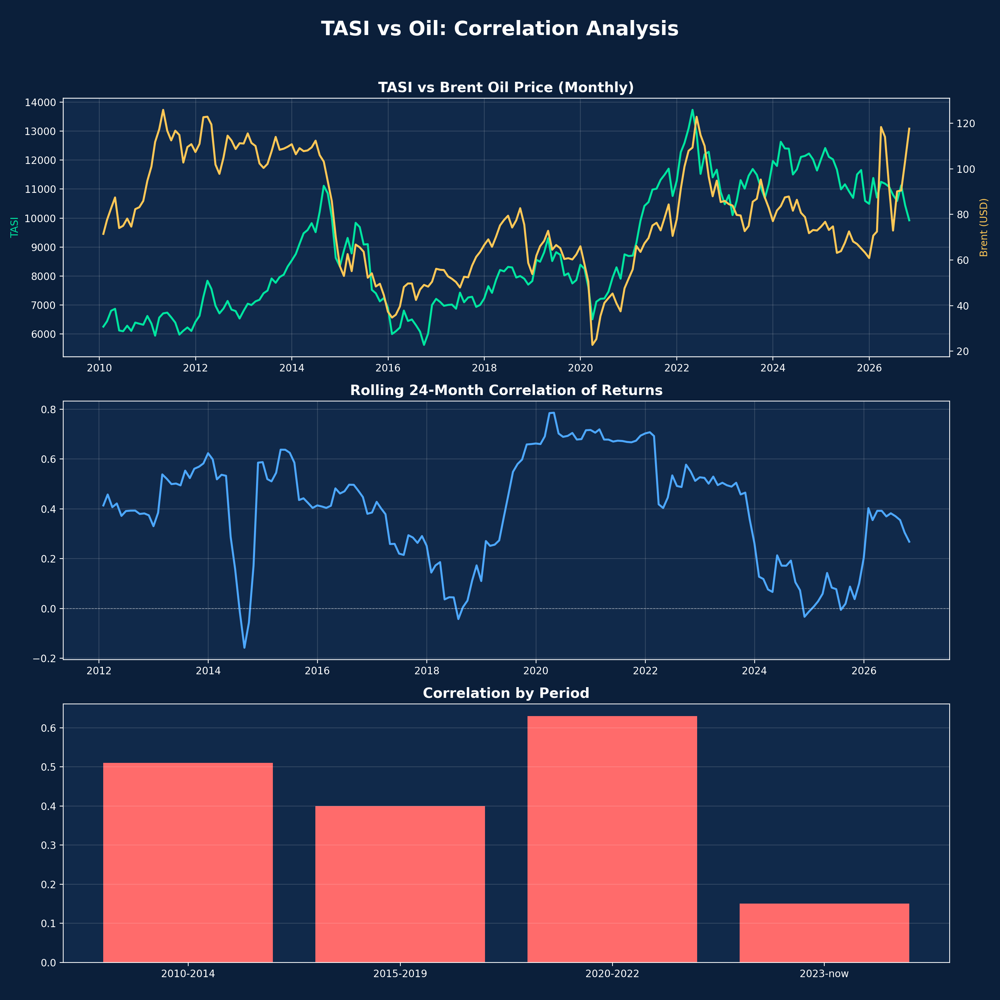

# TASI vs Brent Oil: Correlation Analysis

Does Saudi Arabia's stock market move with oil prices? This project measures the relationship between monthly returns of the Tadawul All Share Index (TASI) and Brent crude oil from 2010 to 2026.

## Dashboard

## Key Findings
- Overall correlation of monthly returns: **0.41** (moderate, positive).
- Correlation by period: 2010-2014: 0.51 | 2015-2019: 0.40 | 2020-2022: 0.63 | 2023-2026: 0.15.
- The relationship is strongest during 2020-2022, a period of sharp oil price swings.
- It weakens notably after 2023, which may reflect a growing role of non-oil factors in the market. This is a possible interpretation, not a proven cause: correlation does not imply causation.

## Method
1. Loaded daily TASI data (Investing.com) and daily Brent prices (Yahoo Finance).
2. Converted both to month-end prices and computed monthly % returns.
3. Calculated overall, period-based, and rolling 24-month correlations.

## Limitations
- Correlation does not establish causation.
- Results depend on the chosen period splits.
- Monthly returns only; no controls for other factors (global markets, interest rates).

## Tools
Python, pandas, matplotlib, yfinance, Google Colab

## Data Sources
- TASI: Investing.com
- Brent crude: Yahoo Finance (BZ=F)
  
